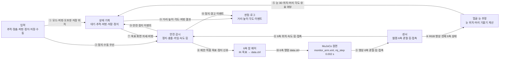

# D06 시스템 구조 · D08 안전 개념

D06·D08 · 작성 1인 팀 · 상태 개정 · v0.3 · 관련 [D03 요구사항 명세](D03-requirements.md)(R-01~R-12), [D07 장면 구성표](D07-scene.md)

모듈 흐름: 입력·센서 → 얼굴·눈 추정 → 상태 기계 → 안전 감시 → 6축 암 제어 → (mj_step) → 센서 … / 판정·로그

이 문서는 MuJoCo 장면(`scenes/monitor_arm.xml`)을 기준으로 모듈 경계와 안전 규칙을 정리한 것이다. 기존 MediaPipe 브라우저 3D 데모와는 별개이며, 제어·인식 모듈 코드는 아직 작성하지 않았다.

## 1. 기구 구성 (6축, SCARA 형식 고려중)

4가지 자세(똑바로 앉기·앞으로 숙이기·기대 눕기·서기)의 거리·높이·기울기·좌우 위치 보정과 모니터 가로·세로 피벗 전환(R-06)을 모두 지원하기 위해 **6축(6-DOF)**으로 구성한다. 기구 방식은 **SCARA 형식(수직 승강 + 수평 2링크 회전) + 손목 3축**을 현재 고려 중인 기본 후보로 잡았다(추후 일반 6축 수직 다관절 방식과 작업 공간·토크·충돌 여유를 비교할 수 있다).

- 1축 `arm_lift` (수직 승강, Z 직선): 눈높이 맞춤(R-02)과 피벗 전환 시 책상 여유 확보(R-06, R-10)
- 2축 `arm_shoulder_yaw` (SCARA 1링크, Z 회전): 책상 위 수평 평면 도달
- 3축 `arm_elbow_yaw` (SCARA 2링크, Z 회전): 앞으로 숙이기·기대 눕기 거리 0.50~0.70 m 유지(R-01) 및 좌우 이동
- 4축 `wrist_yaw` (손목 좌우 방향, Z 회전): 2·3축 회전 상쇄 및 사용자 정면 방향 유지(R-03)
- 5축 `wrist_pitch` (손목 상하 기울기, X 회전): 화면 법선이 얼굴을 향하게 맞춤(R-03)
- 6축 `wrist_roll` (손목 피벗, Y 회전): 모니터 가로형(0°) ↔ 세로형(90°) 전환(R-06)

## 2. 모듈 관계도

고리는 `감지(입력·센서·얼굴·눈 추정) → 판단(상태 기계·안전 감시) → 행동(6축 암 제어) → 진행(mj_step)` 순서다. 화살표 번호는 3절 인터페이스 표의 줄과 같다.

| 모듈 | 맡는 일 | 현재 상태 |
|---|---|---|
| 입력 | 자동 추적/맞춤(R-01~R-04), 가로/세로 피벗(R-06), 저장 위치(R-07), 정지·수동 조작(R-09), 오프셋 전달 | 예정 |
| MuJoCo 장면 | 책상·뒷벽·6축 SCARA 모니터암·웹캠·5자세 사람 대역·의자 물리 진행 (`scenes/monitor_arm.xml`) | 작성 완료 (v2) |
| 센서 | 웹캠 RGB 렌더, 6축 관절 위치·속도, `act_lift` 힘, `data.contact` 읽기 | 장면 센서 정의 완료 |
| 얼굴·눈 추정 | 웹캠 영상에서 눈 중심 3D 위치와 머리 기울기 추정(세로형 90° 보정 포함), 실패 판정(R-08). 프레임은 메모리 처리 후 즉시 폐기(R-12) | 예정 |
| 상태 기계 | 대기 / 추적 / 피벗 전환(승강 후 회전) / 저장 위치 이동 / 정지 상태 전환 | 예정 |
| 안전 감시 | 정지·수동 우선(R-09), 책상·뒷벽·링크 끼임과 사람 충돌 감시(R-10), 속도·힘 제한(R-11), 명령 끊김 감시 | 예정 |
| 6축 암 제어 | 목표 화면 위치·기울기·피벗을 SCARA 2링크 역기구학 + 손목 3축 각도로 풀고 속도 제한을 걸어 `data.ctrl` 출력 | 예정 |
| 판정·로그 | R-01~R-06 수치(거리·높이 오차·각도차·피벗·도달 시간)와 안전 이벤트 기록 (영상 제외, R-12) | 예정 |

## 3. 인터페이스 표

단위는 길이 `m`, 각도 `rad`, 선속도 `m/s`, 각속도 `rad/s`, 힘 `N`, 시간 `s`다. 주기와 문턱 숫자는 실측 전이므로 `(잠정)` 또는 `(가정)`으로 표시했다.

| 번호 | 보내는 쪽 → 받는 쪽 | 데이터 | 형식·단위 | 언제 | 관련 R |
|---|---|---|---|---|---|
| ① | 입력 → 상태 기계 | 명령, 피벗, 오프셋, 저장 슬롯 | `cmd ∈ {auto_once, track_on, track_off, pivot_toggle, preset_*, save_*}`, `offset_m` m | 버튼·모드 입력 때 | R-01, R-04, R-06, R-07 |
| ② | 입력 → 안전 감시 | 정지·수동 조작 신호 | `stop` True/False, `manual_override` True/False | 입력 즉시 (매 제어 주기 확인) | R-09 |
| ③ | MuJoCo → 센서 | 웹캠 영상, 6축 관절·힘, 접촉 | RGB `uint8` H×W×3, `q_lift` m, `q[1..5]` rad, 속도, `f_lift` N, `contact` | 관절·접촉: 매 `mj_step`(0.002 s), 영상: 추정 주기 | R-01~R-03, R-08, R-10, R-11 |
| ④ | 센서 → 얼굴·눈 추정 | 웹캠 RGB 영상, 현재 6축 상태 | RGB `uint8` H×W×3, `q_lift` m, `q[1..5]` rad (`wrist_roll` 포함) | 자동 맞춤 때 또는 추적 주기(10 Hz, 가정) | R-01~R-03, R-06, R-08, R-12 |
| ⑤ | 얼굴·눈 추정 → 상태 기계 | 눈 위치, 머리 기울기, 유효 여부 | `valid` True/False, `eye_xyz` m, `head_pitch` rad, `reason` 문자열 | 추정 1회 끝날 때 | R-01~R-04, R-08 |
| ⑥ | 센서 → 안전 감시 | 6축 위치·속도, 구동기 힘, 접촉 | `q` (m, rad 5개), `v` (m/s, rad/s 5개), `f_lift` N, `contact` True/False | 매 제어 주기 (50 Hz, 가정) | R-10, R-11 |
| ⑦ | 상태 기계 → 안전 감시 | 목표 6축 자세, 피벗 상태, 이동 허가 | `target_xyz` m, `(yaw, pitch, roll)` rad, `enable` True/False | 목표 갱신 때 / 매 제어 주기 | R-01~R-07 |
| ⑧ | 안전 감시 → 6축 암 제어 | 제한 적용 목표, 정지 신호, 속도 상한 | `safe_q[0..5]` (m, rad), `halt` True/False, `v_lin_max` m/s, `v_ang_max` rad/s | 매 제어 주기 | R-09~R-11 |
| ⑨ | 안전 감시 → 상태 기계 | 안전 정지 이벤트 | `(t s, reason)` (`reason ∈ {stop_btn, manual, pinch_limit, pivot_clearance, contact, force, speed, watchdog}`) | 정지가 걸릴 때 | R-09~R-11 |
| ⑩ | 6축 암 제어 → MuJoCo | 6축 액추에이터 명령 | `data.ctrl[act_lift]` m (0.00~0.58), `[shoulder_yaw, elbow_yaw, wrist_yaw, wrist_pitch, wrist_roll]` rad | 매 제어 주기 | R-01~R-06, R-11 |
| ⑪ | 상태 기계 → 판정·로그 | 자세·피벗 맞춤 결과 | `pose`, `dist_m` m, `height_err_mm` mm, `angle_deg` deg, `roll_deg` deg, `elapsed_s` s | 이동이 끝날 때 | R-01~R-07 |
| ⑫ | 안전 감시 → 판정·로그 | 안전 이벤트 | JSON 한 줄 `{"t": s, "reason": ..., "q": [...]}` (영상 데이터 제외) | 이벤트마다 | R-08~R-12 |

## 4. D08 안전 개념

시뮬레이션이라도 하면 안 되는 일과 막는 동작을 적는다. 숫자는 D03과 같은 잠정 기준이며, watchdog 시간은 가정이다.

| 번호 | 하면 안 되는 일 | 감지 방법 | 막는 동작 | 관련 R |
|---|---|---|---|---|
| S-01 | 모니터·SCARA 수평 링크와 책상·뒷벽 사이 끼임(피벗 회전 중 모서리 충돌 포함) | 모니터 8개 꼭짓점·링크 위치로 책상 여유(< 50 mm, 잠정)·뒷벽 여유(< 50 mm, 잠정) 검사, `data.contact`·구동기 힘 감시 | 여유 하한을 넘는 목표 차단. 피벗 회전 전에는 대각 반경(0.354 m)을 고려해 `arm_lift`를 먼저 올려 여유 확보 후 회전. 접촉·힘 초과 시 즉시 정지 | R-06, R-10 |
| S-02 | 이동·수평 선회 중 사람 머리·상체 쪽 충돌 | `user_head`·`user_torso` 접촉(`data.contact`) 또는 예상 외력 급증 감지 | 즉시 정지(`halt=True`), 정지 사유 기록, 새 자동 명령 전까지 재시작 금지 | R-10 |
| S-03 | 암이 너무 빠르거나 큰 힘으로 움직임 | 매 제어 주기 직선 속도(0.15 m/s, 잠정), 관절 각속도(0.5 rad/s, 잠정), 구동기 힘(±80 N, 잠정) 검사 | 제어기에서 속도·힘 상한 적용. 초과가 지속되면 이동 중단 | R-11 |
| S-04 | 정지 버튼이나 수동 조작 중에 자동 이동이 계속됨 | 정지 버튼 입력 또는 수동 조작 입력·손으로 미는 외력 감지 | 자동 이동·추적 즉시 취소, 현재 위치 유지. 새 자동 명령 전까지 대기 | R-09 |
| S-05 | 얼굴이 안 보이는데 임의 위치로 자동 이동 | 얼굴·눈 추정 모듈의 `valid=False`(시야 이탈·가림·신뢰도 미달) | 자동 이동을 시작하지 않고 현재 위치 유지, 사유만 기록 | R-08 |
| S-06 | 제어 명령이 끊겨도 계속 움직임 | 제어 신호 수신 간격 감시(0.5 s 새 명령 없음, watchdog, 가정) | 목표 속도 0으로 현재 위치 고정, 정지 이벤트 기록 | R-09·R-11 보조 |
| S-07 | 웹캠 영상이 디스크에 저장되거나 외부로 나감 | 얼굴·눈 추정 및 로그 모듈 입출력 점검 | 프레임은 메모리에서 눈 좌표·머리 각도만 추출한 뒤 즉시 폐기. 저장·전송 금지, 로그에는 수치만 남김 | R-12 |
