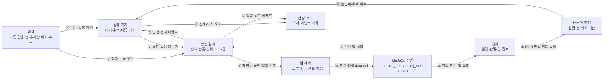

# D06 시스템 구조 · D08 안전 개념

D06·D08 · 작성 1인 팀 · 상태 작성 · v0.1 · 관련 [D03 요구사항 명세](D03-requirements.md)(R-01~R-04), [D07 장면 구성표](D07-scene.md)

모듈 흐름: 입력·센서 → 눈높이 추정 → 상태 기계 → 안전 감시 → 암 제어 → (mj_step) → 센서 … / 판정·로그

이 문서는 MuJoCo 장면(`scenes/monitor_arm.xml`) 기준으로 모듈 경계와 안전 규칙을 정리한 초안이다. 기존 MediaPipe 브라우저 3D 데모와는 별개이며, 아래 제어·인식 모듈 코드는 아직 작성하지 않았다.

## 1. 모듈 관계도

고리는 `감지(입력·센서·눈높이 추정) → 판단(상태 기계·안전 감시) → 행동(암 제어) → 진행(mj_step)` 순서다. 화살표 번호는 2절 인터페이스 표의 줄과 같다.

| 모듈 | 맡는 일 | 현재 상태 |
|---|---|---|
| 입력 | 자동 맞춤(R-01), 정지(R-03), 앉기·서기 저장/불러오기(R-04), 사용자 오프셋, 수동 조작 입력 전달 | 예정 |
| MuJoCo 장면 | 책상·모니터암·웹캠·사람 머리 물리 진행 (`scenes/monitor_arm.xml`) | 작성 완료 (v0) |
| 센서 | 웹캠 RGB 렌더, `arm_lift`·`arm_tilt` 위치·속도·구동기 힘, `data.contact` 읽기 | 장면 센서 정의 완료 |
| 눈높이 추정 | 웹캠 영상에서 눈 중심 높이를 추정하고 실패 여부 판정(R-02). 프레임은 메모리에서만 처리하고 즉시 폐기 | 예정 |
| 상태 기계 | 대기 / 추정 / 자동 이동 / 저장 위치 이동 / 정지 상태 전환(R-01~R-04) | 예정 |
| 안전 감시 | 정지 버튼·수동 조작 우선 처리, 스트로크·속도·힘 제한, 끼임·충돌·명령 끊김 감시 | 예정 |
| 암 제어 | 목표 높이·기울기를 속도 제한이 걸린 `data.ctrl` 값으로 변환 | 예정 |
| 판정·로그 | 목표와 도달 높이 차이(R-01, 잠정 10 mm 이하)와 정지·오류 이벤트 기록 | 예정 |

## 2. 인터페이스 표

길이는 `m`, 각도는 `rad`, 속도는 `m/s`, 힘은 `N`, 시간은 `s`를 쓴다. 주기와 문턱 숫자는 아직 검증 전이므로 `(가정)`으로 표시했다.

| 번호 | 보내는 쪽 → 받는 쪽 | 데이터 | 형식·단위 | 언제 | 관련 R |
|---|---|---|---|---|---|
| ① | 입력 → 상태 기계 | 명령 종류, 오프셋, 저장 슬롯 | `cmd ∈ {auto, preset_sit, preset_stand, save_sit, save_stand}`, `offset_m` (m) | 버튼 입력 때 | R-01, R-04 |
| ② | 입력 → 안전 감시 | 정지·수동 조작 신호 | `stop` (True/False), `manual_override` (True/False) | 입력 즉시 (매 제어 주기 확인) | R-03 |
| ③ | MuJoCo → 센서 | 웹캠 영상, 관절·힘, 접촉 | RGB `uint8` H×W×3, `q_lift` m, `v_lift` m/s, `f_lift` N, `q_tilt` rad, `contact` 목록 | 관절·접촉: 매 `mj_step`(0.002 s), 영상: 요청 때 | R-01, R-02 |
| ④ | 센서 → 눈높이 추정 | 웹캠 RGB 영상, 현재 암 높이·기울기 | RGB `uint8` H×W×3, `q_lift` m, `q_tilt` rad | 자동 맞춤 버튼 누른 직후 | R-01, R-02 |
| ⑤ | 눈높이 추정 → 상태 기계 | 추정 눈높이, 유효 여부 | `valid` (True/False), `eye_z` m, `reason` 문자열 | 추정 1회 끝날 때 | R-01, R-02 |
| ⑥ | 센서 → 안전 감시 | 관절 위치·속도, 구동기 힘, 접촉 여부 | `q_lift` m, `v_lift` m/s, `f_lift` N, `contact` (True/False) | 매 제어 주기 (50 Hz, 가정) | R-03 |
| ⑦ | 상태 기계 → 안전 감시 | 목표 높이·기울기, 이동 허가 | `target_lift` m, `target_tilt` rad, `enable` (True/False) | 상태가 바뀔 때 / 매 제어 주기 | R-01, R-04 |
| ⑧ | 안전 감시 → 암 제어 | 제한 적용 목표, 즉시 정지 신호 | `safe_lift` m, `safe_tilt` rad, `halt` (True/False), `v_max` m/s | 매 제어 주기 | R-01, R-03 |
| ⑨ | 안전 감시 → 상태 기계 | 안전 정지 이벤트 | `(t s, reason)` (`reason ∈ {stop_btn, manual, contact, force, limit, watchdog}`) | 정지가 걸릴 때 | R-03 |
| ⑩ | 암 제어 → MuJoCo | 액추에이터 명령 | `data.ctrl[act_lift]` m (0.0~0.50), `data.ctrl[act_tilt]` rad (-0.26~0.26) | 매 제어 주기 | R-01, R-03, R-04 |
| ⑪ | 상태 기계 → 판정·로그 | 이동 결과 | `mode`, `target_z` m, `reached_z` m, `err_mm` mm, `elapsed_s` s | 이동이 끝날 때 | R-01, R-04 |
| ⑫ | 안전 감시 → 판정·로그 | 안전 이벤트 | JSON 한 줄 `{"t": s, "reason": ..., "q_lift": m}` (영상 데이터 제외) | 이벤트마다 | R-02, R-03 |

## 3. D08 안전 개념

시뮬레이션 단계에서도 하면 안 되는 일과 막는 동작을 미리 정한다. 아래 표의 속도·힘·여유 거리·감시 시간 숫자는 아직 실측 전이므로 모두 가정이다.

| 번호 | 하면 안 되는 일 | 감지 방법 | 막는 동작 | 관련 R |
|---|---|---|---|---|
| S-01 | 모니터와 책상·뒷벽 사이 끼임 | `monitor_bottom` 높이 하한 검사(책상 윗면 + 50 mm 이상, 가정) 및 책상·벽 `data.contact`·구동기 힘 검사 | 하한 이하 이동 명령 차단. 접촉 또는 힘 초과 시 즉시 정지하고 현재 위치 유지 | D03 미반영 (후보) |
| S-02 | 이동 중 사람 머리·손 쪽 충돌 | `user_head` 접촉(`data.contact`) 또는 예상 하중 이상의 외력(`arm_lift_force` 급증) 감지 | 즉시 정지(`halt=True`), 정지 이유 기록, 새 명령 전까지 재시작 금지 | D03 미반영 (후보) |
| S-03 | 모니터암이 너무 빠르거나 큰 힘으로 움직임 | 매 제어 주기 `arm_lift_vel` 상한(0.10 m/s, 가정) 및 `act_lift` 힘 제한(±80 N, 가정) 검사 | 제어기에서 속도·힘 상한 적용. 제한 초과가 지속되면 이동 중단 | D03 미반영 (후보) |
| S-04 | 정지 버튼이나 수동 조작 중에 자동 이동이 계속됨 | 정지 버튼 입력(R-03) 또는 수동 조작 입력·손으로 미는 외력 감지 | 자동 이동 즉시 취소하고 위치 유지. 새 자동 맞춤·저장 위치 명령 전까지 대기 | R-03 (수동 우선은 D03 후보) |
| S-05 | 얼굴이 안 보이는데 임의 높이로 자동 이동 | 눈높이 추정 모듈의 `valid=False`(얼굴 미검출·시야 이탈·신뢰도 미달) | 자동 이동을 시작하지 않고 현재 위치 유지, 실패 사유만 표시·기록 | R-02 |
| S-06 | 제어 명령이 끊겨도 계속 움직임 | 제어 신호 수신 간격 감시(0.5 s 새 명령 없음, watchdog, 가정) | 목표 속도를 0으로 두고 현재 위치 고정, 정지 이벤트 기록 | D03 미반영 (후보) |
| S-07 | 웹캠 영상이 디스크에 저장되거나 외부로 나감 | 눈높이 추정·로그 모듈 입출력 검토(개인정보 규칙) | 프레임은 메모리에서 눈 좌표만 뽑은 뒤 즉시 폐기. 파일 저장·외부 전송 금지, 로그에는 좌표와 상태 숫자만 남김 | D03 미반영 (후보) |

현재 [D03 요구사항 명세](D03-requirements.md)에는 `R-01~R-04`만 있으며, 이 가운데 안전과 직접 이어지는 항목은 `R-02`(추정 불가 시 미이동)와 `R-03`(정지 버튼)이다. S-01~S-03, S-04의 수동 조작 우선, S-06, S-07은 다음 단계에서 D03 안전 요구사항으로 추가할지 결정이 필요하다.
