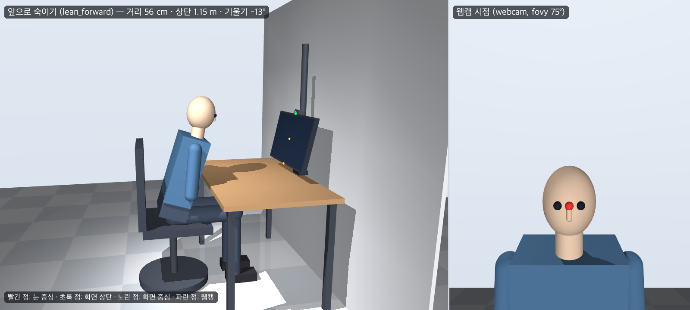
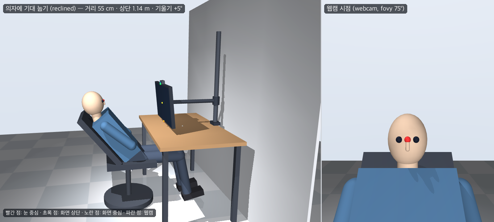
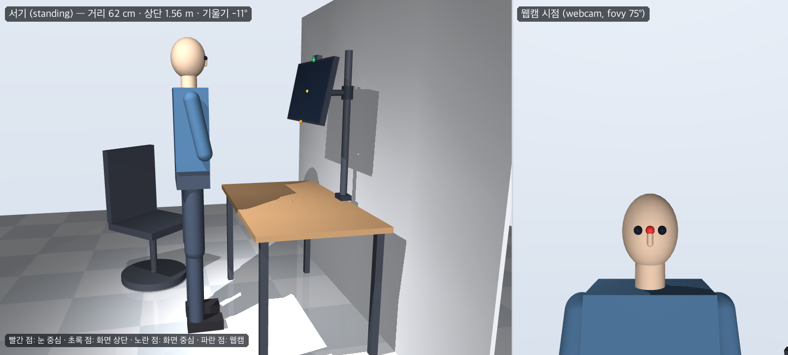

# D07 장면 구성표

D07 · 장면 구성표 · 작성 1인 팀 · 상태 개정 · v0.2 · 파일 `scenes/monitor_arm.xml` · 관련 [D03 요구사항 명세](D03-requirements.md)(R-01~R-11), [D06·D08 시스템 구조·안전 개념](D06-architecture.md)

## 1. 장면 구성표

| 항목 | 내용 |
|---|---|
| 로봇 모델 | 4축 모니터암(`arm_lift` 높이 0.55 m, `arm_reach` 앞뒤 0.53 m, `arm_yaw` ±30°, `arm_tilt` ±26°) + 27인치 모니터(0.61 × 0.03 × 0.36 m, 4.5 kg). 구동부 전체 질량 6.8 kg |
| 작업 대상 | 성인 전신 대역(`user_head`, `user_torso`, `user_thighs`, `user_shins`, mocap)과 사무용 의자(`office_chair`, `chair_backrest`). 눈 두 개(동공간 거리 64 mm)와 눈 중심(`eye_center`) 표시. 키프레임 4종(`seated`, `lean_forward`, `reclined`, `standing`) |
| 고정물 | 바닥(`z = 0`), 뒷벽(`y = 0.44 m`, 앞면 `0.43 m`), 일반 사무 책상(1.20 × 0.70 × 0.72 m), 책상 뒤쪽 고정 기둥(높이 0.90 m) |
| 센서 | 모니터 상단 웹캠(`webcam`, 세로 시야 75° 가정), 4축 관절 위치·속도, `act_lift`·`act_reach` 구동기 힘, `monitor_center`·`monitor_top`·`eye_center` 위치 센서, 접촉(`data.contact`) |
| 무작위로 바꿀 값 | 평가 시 눈높이 ±5 cm, 앞뒤 거리 ±10 cm, 머리 기울기 ±5°, 사용자 좌우 틀어짐(±15°, 가정), 얼굴 시야 이탈 조건(R-07) |
| 플랫폼 결정 | 기존 MediaPipe 브라우저 3D 데모와는 별개로 MuJoCo 기본 도형 장면 v1을 작성했다. 6축 로봇팔 대신 4가지 자세 대응에 필요한 4축으로 단순화했으며, 이전 브라우저 데모 결과는 이 장면에 쓰지 않는다. |

## 2. 치수·질량과 근거

좌표계는 월드 기준(`m`, `+Z` 위, `+Y` 벽 쪽, `-Y` 사용자 쪽)이다. 확인되지 않은 값은 가정으로 적었다.

| 대상 | 값 | 근거 |
|---|---|---|
| 사무 책상 (가로 × 깊이 × 높이) | 1.20 × 0.70 × 0.72 m | 일반 사무용 책상 흔한 규격(높이 72~74 cm) 기준 가정 |
| 뒷벽 앞면 위치 | `y = 0.43 m` (책상 뒷면에서 8 cm 뒤) | 벽과 모니터 사이 끼임·여유(R-09, 50 mm 이상) 확인용 가정 |
| 27인치 모니터 (가로 × 두께 × 높이) | 0.61 × 0.03 × 0.36 m, 4.5 kg | 일반 27인치 16:9 모니터(스탠드 제외 4~5 kg) 기준 가정 |
| 1축 높이 (`arm_lift`) | 스트로크 0.55 m (화면 중심 `z = 0.90 ~ 1.45 m`) | 고정 책상(0.72 m)에서 기대 눕기~서기 눈높이를 모두 맞추고 책상 여유(50 mm 이상, R-09) 확보용 가정 |
| 2축 앞뒤 (`arm_reach`) | 범위 `-0.38 ~ +0.15 m` (총 0.53 m, 화면 앞면 `y = -0.28 ~ +0.25 m`) | 앞으로 숙일 때 물러나고 기대 누울 때 다가와 거리 0.50~0.70 m(R-01) 유지용 가정 |
| 3·4축 회전 (`arm_yaw`, `arm_tilt`) | `arm_yaw` ±0.52 rad(±30°), `arm_tilt` ±0.45 rad(±26°) | 좌우 틀어짐과 상하 시선 각도차 10° 이내(R-03) 대응용 가정 |
| 성인 체형·자세 (4 키프레임) | 똑바로 앉기 눈높이 1.20 m, 앞으로 숙이기 1.15 m, 기대 눕기 0.99 m(등받이 36°·머리 +14°), 서기 1.56 m(발바닥 `z = 0`) | 성인 평균 신장 약 167~168 cm, 의자 좌판 0.44 m 기준 가정 |
| 웹캠 위치·화각 | 모니터 상단 중앙(`z_top + 0.015 m`), `fovy = 75°` | 자세 전환 직후에도 얼굴이 화각 안에 남도록 광각 가정 |

## 3. 확인 코드 기대값과 실행 결과

기대값:
- 관절 4개(`arm_lift`, `arm_reach`, `arm_yaw`, `arm_tilt`), 액추에이터 4개, 카메라 1개(`webcam`), 구동부 질량 합 6.8 kg
- 4개 키프레임 각각 1초 물리 진행 후 R-01(거리 0.50~0.70 m), R-02(상단 오차 ≤ 15 mm), R-03(화면 법선–시선 각도차 ≤ 10°), R-09(책상·벽 여유 ≥ 50 mm, 접촉 0건) 모두 통과

실행 결과(`scripts/check_scene.py`, MuJoCo 4.0.1):

```text
$ uv run python scripts/check_scene.py
모델: monitor_arm.xml (MuJoCo 4.0.1)
관절 4개 ['arm_lift', 'arm_reach', 'arm_yaw', 'arm_tilt'], 액추에이터 4개 ['act_lift', 'act_reach', 'act_yaw', 'act_tilt'], 카메라 1개 ['webcam']
구동부 질량 합 6.8 kg (모니터+VESA 4.8 kg)
[seated      ] PASS | 거리 0.621 m (R-01) | 상단 1.200/목표 1.200 m (오차 0.2 mm, R-02) | 각도차 5.1도 (R-03) | 책상여유 127 mm · 벽여유 290 mm · 접촉 0건 (R-09)
[lean_forward] PASS | 거리 0.561 m (R-01) | 상단 1.152/목표 1.152 m (오차 0.2 mm, R-02) | 각도차 5.6도 (R-03) | 책상여유 81 mm · 벽여유 150 mm · 접촉 0건 (R-09)
[reclined    ] PASS | 거리 0.548 m (R-01) | 상단 1.137/목표 1.134 m (오차 3.3 mm, R-02) | 각도차 9.3도 (R-03) | 책상여유 59 mm · 벽여유 600 mm · 접촉 0건 (R-09)
[standing    ] PASS | 거리 0.621 m (R-01) | 상단 1.560/목표 1.560 m (오차 0.2 mm, R-02) | 각도차 5.1도 (R-03) | 책상여유 487 mm · 벽여유 310 mm · 접촉 0건 (R-09)
```

## 4. 자세별 장면 스크린샷 (4종)

`scripts/render_scene.py`로 MuJoCo에서 4개 키프레임을 렌더링한 결과다. 왼쪽은 측면 대각선 시점, 오른쪽은 모니터 상단 `webcam` 시점이다.

### 1) 똑바로 앉기 (`seated`)


눈–화면 거리 62 cm, 화면 상단 1.20 m(눈높이 일치), 화면을 뒤로 11° 기울여 시선과 법선 차이를 5.1°로 맞췄다.

### 2) 앞으로 숙이기 (`lean_forward`)



상체가 앞으로 기울어진 만큼 `arm_reach`가 뒤로 물러나 거리 56 cm를 유지한다(뒷벽 여유 150 mm, 책상 여유 81 mm).

### 3) 의자에 기대 눕기 (`reclined`)



등받이에 기대 뒤로 물러난 얼굴을 따라 화면이 앞으로 다가오고 내려오며(+5° 아래로 기울임) 거리 55 cm와 각도차 9.3°를 맞춘다.

### 4) 서기 (`standing`)



의자를 옆으로 치우고 바닥에 서 있는 상태(눈높이 1.56 m)에 맞춰 `arm_lift`가 올라가 거리 62 cm, 상단 오차 0.2 mm를 유지한다.

## 5. 추후 확인·결정할 점

- 기대 눕기와 앞으로 숙이기를 모두 맞추려면 앞뒤 스트로크가 약 0.45 m 이상 필요하다(`arm_reach`는 0.53 m로 잡았다). 실제 기구에서는 신축 레일 대신 접이식 링크로 바꿀지 결정이 필요하다.
- 기대 눕기에서는 머리가 뒤로 젖혀져 위를 보므로 R-02 목표 높이를 수평 눈높이가 아닌 머리 정면 시선선 기준으로 잡았다. 이 기준을 그대로 쓸지, 수평 눈높이 기준의 별도 오프셋으로 둘지 확인이 필요하다.
- MuJoCo에서는 키프레임 4종의 기하 조건과 웹캠 화각만 확인했다. 실시간 얼굴·눈 추적과 4초 이내(R-05) 추종 제어는 다음 단계에서 구현한다.
