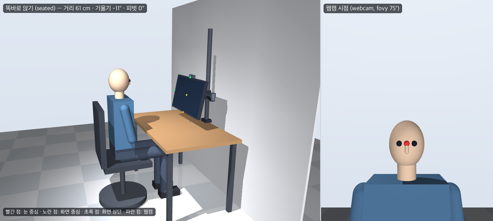
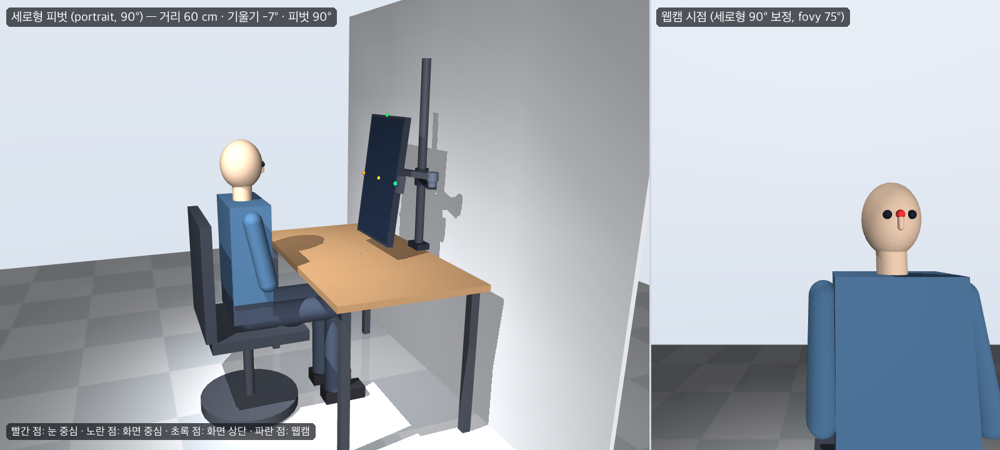

# D07 장면 구성표

D07 · 장면 구성표 · 작성 1인 팀 · 상태 개정 · v0.3 · 파일 `scenes/monitor_arm.xml` · 관련 [D03 요구사항 명세](D03-requirements.md)(R-01~R-12), [D06·D08 시스템 구조·안전 개념](D06-architecture.md)

## 1. 장면 구성표

| 항목 | 내용 |
|---|---|
| 로봇 모델 | 6축 SCARA 형식(고려중) + 손목 3축 모니터암: 수직 승강(`arm_lift` 0.58 m) + 수평 2링크(`arm_shoulder_yaw`, `arm_elbow_yaw`, 각 L = 0.28 m, 4.4 cm 수직 단차) + 손목 3축(`wrist_yaw`, `wrist_pitch`, `wrist_roll` 0°~90°) + 27인치 모니터(0.61 × 0.03 × 0.36 m, 4.5 kg). 구동부 전체 질량 7.4 kg |
| 작업 대상 | 성인 전신 대역(`user_head`, `user_torso`, `user_thighs`, `user_shins`, mocap)과 사무용 의자(`office_chair`, `chair_backrest`). 눈 두 개(동공간 거리 64 mm)와 눈 중심(`eye_center`) 표시. 키프레임 5종(`seated`, `lean_forward`, `reclined`, `standing`, `portrait`) |
| 고정물 | 바닥(`z = 0`), 뒷벽(`y = 0.44 m`, 앞면 `0.43 m`), 일반 사무 책상(1.20 × 0.70 × 0.72 m), 책상 뒤쪽 고정 기둥(높이 0.95 m) |
| 센서 | 모니터 웹캠(`webcam`, 세로 시야 75° 가정), 6축 관절 위치·속도, `act_lift` 구동기 힘, `monitor_center`·`monitor_top`·`eye_center` 위치 센서, 접촉(`data.contact`) |
| 무작위로 바꿀 값 | 평가 시 눈높이 ±5 cm, 앞뒤 거리 ±10 cm, 머리 기울기 ±5°, 사용자 좌우 틀어짐 ±15°(가정), 가로/세로 모드 전환(R-06), 얼굴 시야 이탈 조건(R-08) |
| 플랫폼 결정 | 기존 MediaPipe 브라우저 3D 데모와는 별개로 MuJoCo 기본 도형 장면 v2를 작성했다. 6축 기구 중 SCARA 형식을 기본 후보로 구현했으며(추후 일반 6축 다관절과 비교 가능), 이전 브라우저 데모 결과는 이 장면에 쓰지 않는다. |

## 2. 치수·질량과 근거

좌표계는 월드 기준(`m`, `+Z` 위, `+Y` 벽 쪽, `-Y` 사용자 쪽)이다. 확인되지 않은 값은 가정으로 적었다.

| 대상 | 값 | 근거 |
|---|---|---|
| 사무 책상 (가로 × 깊이 × 높이) | 1.20 × 0.70 × 0.72 m | 일반 사무용 책상 흔한 규격(높이 72~74 cm) 기준 가정 |
| 뒷벽 앞면 위치 | `y = 0.43 m` (책상 뒷면에서 8 cm 뒤) | 벽과 모니터·SCARA 링크 사이 끼임·여유(R-10, 50 mm 이상) 확인용 가정 |
| 27인치 모니터 (가로 × 두께 × 높이) | 0.61 × 0.03 × 0.36 m, 4.5 kg | 일반 27인치 16:9 모니터(스탠드 제외 4~5 kg) 기준 가정 |
| 1축 수직 승강 (`arm_lift`) | 스트로크 0.58 m (손목 중심 `z = 0.90 ~ 1.48 m`) | 고정 책상(0.72 m)에서 기대 눕기~서기 대응과 세로형 피벗 시 책상 여유(50 mm 이상, R-10) 확보용 가정 |
| 2·3축 SCARA 수평 링크 (`arm_shoulder_yaw`, `arm_elbow_yaw`) | 각 링크 길이 `L1 = L2 = 0.28 m` (최대 수평 도달 0.56 m), 관절 범위 `±137°` / `±169°` | 앞으로 숙이기(접힘)와 기대 눕기(뻗음)에서 거리 0.50~0.70 m(R-01)를 확보하면서 팔꿈치가 뒷벽(`y = 0.43 m`)을 넘지 않도록 가정 |
| 4·5·6축 손목 (`wrist_yaw`, `wrist_pitch`, `wrist_roll`) | `yaw ±140°`, `pitch ±26°`, `roll ±90°` (가로 0° / 세로 90°) | SCARA 링크 회전 상쇄, 상하 시선 각도차 10° 이내(R-03), 가로·세로 피벗(R-06) 대응용 가정 |
| 성인 체형·자세 (5 키프레임) | 똑바로 앉기 눈높이 1.20 m, 앞으로 숙이기 1.15 m, 기대 눕기 0.99 m(등받이 36°·머리 +14°), 서기 1.56 m(발바닥 `z = 0`), 세로형은 앉은 자세(1.20 m) 기준 | 성인 평균 신장 약 167~168 cm, 의자 좌판 0.44 m 기준 가정 |
| 웹캠 위치·화각 | 모니터 상단 중앙(세로형 전환 시 측면 이동 + 90° 영상 보정 가정), `fovy = 75°` | 자세 전환 직후에도 얼굴이 화각 안에 남도록 광각 가정 |

## 3. 확인 코드 기대값과 실행 결과

기대값:
- 관절 6개(`arm_lift`, `arm_shoulder_yaw`, `arm_elbow_yaw`, `wrist_yaw`, `wrist_pitch`, `wrist_roll`), 액추에이터 6개, 카메라 1개(`webcam`), 구동부 질량 합 7.4 kg
- 5개 키프레임 각각 1초 물리 진행 후 R-01(거리 0.50~0.70 m), R-02(기준 높이 오차 ≤ 15 mm), R-03(화면 법선–시선 각도차 ≤ 10°), R-10(모니터 8개 꼭짓점 기준 책상·벽 여유 ≥ 50 mm, 접촉 0건) 모두 통과

실행 결과(`scripts/check_scene.py`, MuJoCo 4.0.1):

```text
$ uv run python scripts/check_scene.py
모델: monitor_arm.xml (MuJoCo 4.0.1)
관절 6개 ['arm_lift', 'arm_shoulder_yaw', 'arm_elbow_yaw', 'wrist_yaw', 'wrist_pitch', 'wrist_roll'], 액추에이터 6개 ['act_lift', 'act_shoulder_yaw', 'act_elbow_yaw', 'act_wrist_yaw', 'act_wrist_pitch', 'act_wrist_roll'], 카메라 1개 ['webcam']
구동부 질량 합 7.4 kg (모니터+VESA 4.8 kg)
[seated      ] PASS | 거리 0.614 m (R-01) | 상단 1.200/목표 1.200 m (오차 0.1 mm, R-02) | 각도차 5.2도 (R-03) | 피벗 0도 | 책상여유 121 mm · 벽여유 261 mm · 접촉 0건 (R-10)
[lean_forward] PASS | 거리 0.516 m (R-01) | 상단 1.152/목표 1.152 m (오차 0.7 mm, R-02) | 각도차 7.2도 (R-03) | 피벗 0도 | 책상여유 74 mm · 벽여유 157 mm · 접촉 0건 (R-10)
[reclined    ] PASS | 거리 0.541 m (R-01) | 상단 1.137/목표 1.132 m (오차 4.5 mm, R-02) | 각도차 9.4도 (R-03) | 피벗 0도 | 책상여유 59 mm · 벽여유 591 mm · 접촉 0건 (R-10)
[standing    ] PASS | 거리 0.614 m (R-01) | 상단 1.560/목표 1.560 m (오차 0.1 mm, R-02) | 각도차 5.2도 (R-03) | 피벗 0도 | 책상여유 481 mm · 벽여유 281 mm · 접촉 0건 (R-10)
[portrait    ] PASS | 거리 0.596 m (R-01) | 상단1/3 1.200/목표 1.200 m (오차 0.1 mm, R-02) | 각도차 2.7도 (R-03) | 피벗 90도 | 책상여유 74 mm · 벽여유 260 mm · 접촉 0건 (R-10)
```

## 4. 자세·피벗별 장면 스크린샷 (5종)

`scripts/render_scene.py`로 MuJoCo에서 5개 키프레임을 렌더링한 결과다. 왼쪽은 측면 대각선 시점(SCARA 2링크 배치 확인), 오른쪽은 `webcam` 시점이다.

### 1) 똑바로 앉기 (`seated`)



SCARA 2링크가 적당히 접힌 상태에서 눈–화면 거리 61 cm, 상단 1.20 m(오차 0.1 mm), 각도차 5.2°를 유지한다.

### 2) 앞으로 숙이기 (`lean_forward`)


SCARA 팔꿈치가 오른쪽 뒤로 더 접히며 화면이 뒤로 물러나 거리 52 cm, 뒷벽 여유 157 mm, 책상 여유 74 mm를 유지한다.

### 3) 의자에 기대 눕기 (`reclined`)


SCARA 2링크가 앞으로 뻗으며 화면이 다가오고 내려와(+5° 기울임) 거리 54 cm, 각도차 9.4°를 맞춘다.

### 4) 서기 (`standing`)


바닥에 서 있는 자세(눈높이 1.56 m)에 맞춰 `arm_lift`가 올라가 거리 61 cm, 상단 오차 0.1 mm를 유지한다.

### 5) 세로형 피벗 (`portrait`, 90°)



`wrist_roll`을 90° 돌리고 `arm_lift`를 올려 책상 여유 74 mm를 확보했다. 세로 61 cm 화면의 상단 1/3 읽기선을 눈높이 1.20 m에 맞췄으며, 웹캠은 세로형 90° 영상 보정을 가정했다.

## 5. 추후 확인·결정할 점

- SCARA 형식은 현재 고려 중인 기본 후보이며, 6축 수직 다관절 형식과 도달 범위·구동기 토크·케이블 배선 관점에서 비교 후 확정할 수 있다.
- 세로형 피벗 시 모니터 베젤에 붙은 웹캠이 측면으로 이동한다. 이처럼 측면 배치 후 90° 영상 보정을 쓸지, `wrist_roll` 앞단(회전하지 않는 브래킷)에 별도 고정할지 결정이 필요하다.
- MuJoCo에서는 키프레임 5종의 기하 조건과 접촉 0건만 확인했다. 실시간 얼굴·눈 추적, 피벗 전환 시 자동 승강 궤적, 4초 이내(R-05) 추종 제어는 다음 단계에서 구현한다.
